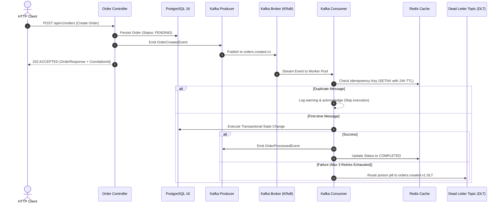

<div align="center">

# ⚡ Distributed Event Pipeline

**A production-grade, event-driven transactional processing engine engineered with Java 21, Spring Boot 3, Apache Kafka, PostgreSQL, and Redis.**

[](https://openjdk.org/)
[](https://spring.io/projects/spring-boot)
[-231f20?style=flat-square&logo=apachekafka&logoColor=white)](https://kafka.apache.org/)
[](https://www.postgresql.org/)
[](https://redis.io/)
[](https://www.docker.com/)

</div>

---

## 📌 Executive Overview

This repository demonstrates the design and implementation of a **resilient, distributed transactional pipeline** capable of handling asynchronous event processing at scale.

Built around clean architecture principles and enterprise messaging best practices, the system tackles the hardest problems in distributed computing:
- **At-Least-Once Delivery Guarantees:** Preventing duplicate side-effects using Redis-backed atomic idempotency locks.
- **Poison Pill Isolation:** Diverting repeatedly failing payloads into Dead Letter Topics (DLT) via exponential backoff retry policies.
- **Observability-First Telemetry:** Full operational visibility through Spring Boot Actuator, Prometheus scrapers, and structured correlation IDs.

---

## 🏗️ Architecture & Event Flow



---

## 🛡️ Key Resilience Patterns

### 1. Atomic Idempotency via Redis (`SETNX`)
To safeguard downstream systems from Kafka's duplicate message deliveries, each incoming event executes an atomic lock against Redis:
```text
SET idempotency:order:<correlationId> PROCESSING NX EX 86400
```
If a message with an identical correlation ID arrives during or after processing, it is safely acknowledged and discarded without duplicating financial or state side-effects.

### 2. Dead Letter Topic (DLT) & Exponential Backoff
Transient failures (network blips, lock timeouts) are retried up to 3 times with fixed backoff intervals. Unrecoverable failures or malformed payloads bypass worker halts and are directed into `orders.created.v1.DLT` for automated auditing and operator inspection.

### 3. Native KRaft Kafka Cluster
Zero reliance on legacy Apache ZooKeeper. The Docker Compose cluster leverages Kafka's native Raft consensus protocol (`KRaft`), reducing deployment complexity and startup latency.

---

## 📂 Project Structure (Clean Architecture)

```text
distributed-event-pipeline/
├── src/main/java/com/caiovaf/pipeline/
│   ├── api/
│   │   ├── controller/          # REST Endpoints (OpenAPI / Swagger specs)
│   │   └── dto/                 # Request/Response data transfer contracts
│   ├── application/
│   │   └── service/             # Business orchestration & transaction boundaries
│   ├── domain/
│   │   ├── event/               # Immutable event records (OrderCreatedEvent)
│   │   └── model/               # JPA Entities and domain state machines
│   ├── infrastructure/
│   │   ├── kafka/               # Producers, Consumers, Error Handlers & DLT
│   │   └── persistence/         # Spring Data JPA repositories
│   └── DistributedPipelineApplication.java
├── src/main/resources/
│   └── application.yml          # Production-ready YAML configurations
├── docker-compose.yml           # Multi-container orchestration (Kafka, Postgres, Redis)
├── Dockerfile                   # Multi-stage Eclipse Temurin Java 21 build
└── pom.xml                      # Maven dependency descriptor
```

---

## 🚀 Quickstart Guide

### Prerequisites
- [Docker](https://www.docker.com/) & Docker Compose
- [Java 21 JDK](https://adoptium.net/) (optional if running inside Docker)
- [Maven 3.9+](https://maven.apache.org/)

### 1. Launch Infrastructure Stack
Start Kafka, PostgreSQL, and Redis in isolated containers:
```bash
docker compose up -d kafka postgres redis
```

Verify that all services are healthy:
```bash
docker compose ps
```

### 2. Run the Application
```bash
mvn spring-boot:run
```
The application will boot and bind to port `8080`.

---

## 🧪 Testing the Pipeline

### Submit an Order
```bash
curl -X POST http://localhost:8080/api/v1/orders \
  -H "Content-Type: application/json" \
  -d '{
    "customerId": "cust_enterprise_99",
    "amount": 250.75
  }'
```

**Response (HTTP 202 Accepted):**
```json
{
  "id": "7b3b4f6e-1d54-469b-98f5-9310a0df3311",
  "correlationId": "4ff19eb0-e190-48e0-b605-7f41c304d9c1",
  "customerId": "cust_enterprise_99",
  "amount": 250.75,
  "status": "PENDING",
  "failureReason": null,
  "createdAt": "2026-11-10T03:30:00Z"
}
```

### Inspect Processed Order Status
Query by the generated `correlationId`:
```bash
curl http://localhost:8080/api/v1/orders/correlation/4ff19eb0-e190-48e0-b605-7f41c304d9c1
```

---

## 📊 Observability & Documentation

- **Swagger UI / OpenAPI Documentation:** `http://localhost:8080/swagger-ui.html`
- **Actuator Health Endpoint:** `http://localhost:8080/actuator/health`
- **Prometheus Metrics Stream:** `http://localhost:8080/actuator/prometheus`

---

## 📄 License

This repository is licensed under the [MIT License](LICENSE).
